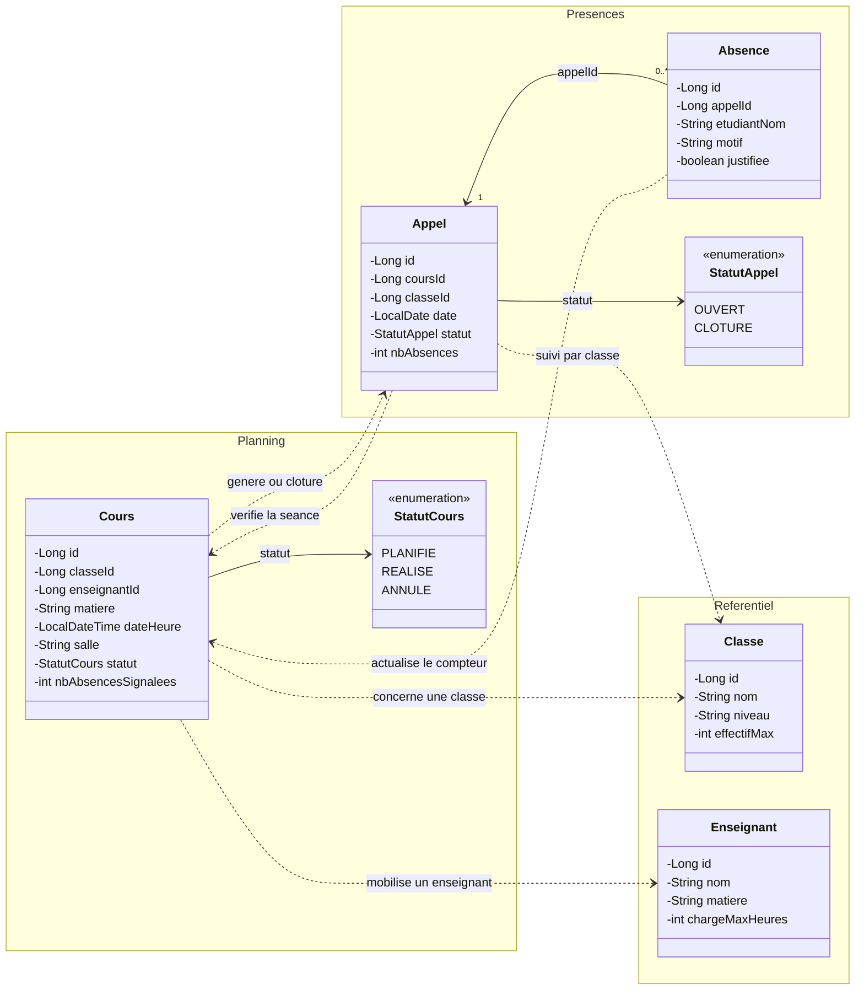
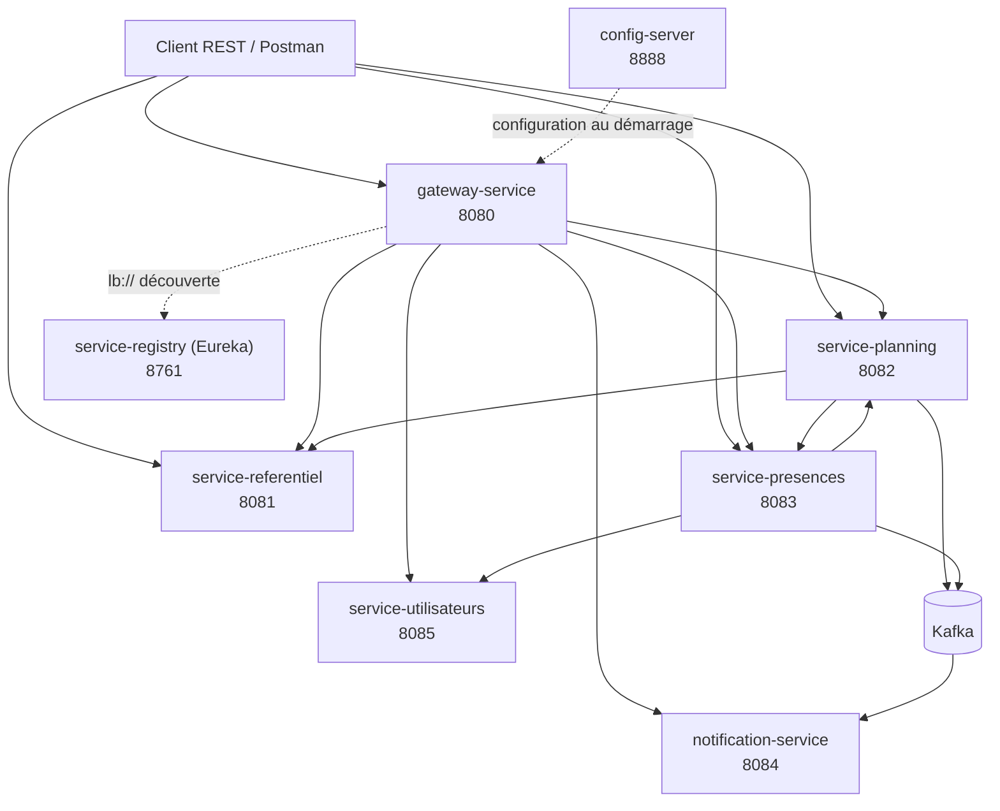

# Planif-Scolaire

Version 1.0 — services métier et API REST.

## Description

Planif-Scolaire permet de planifier les cours d'un établissement et de suivre les absences. Chaque séance associe une classe, une matière, un enseignant, un créneau et une salle. Sa création génère une feuille d'appel. Après la réalisation du cours, les absences saisies mettent à jour son compteur de suivi. L'annulation d'une séance clôture la feuille d'appel.

Le cours suit le cycle `PLANIFIE → REALISE` ou `PLANIFIE → ANNULE`.

## Diagramme de classes UML



Les groupes `Referentiel`, `Planning` et `Presences` correspondent aux trois services métier. Les flèches en pointillés représentent leurs dépendances, sans préciser le protocole de communication. Les références entre services sont conservées sous forme d'identifiants.

Un cours appartient à une seule classe et mobilise un seul enseignant. Une classe ou un enseignant peut être associé à plusieurs cours. Une séance possède au maximum une feuille d'appel, créée après la planification. Chaque absence appartient à un seul appel.

## Architecture déployée

| Application | Port | Rôle |
| --- | --- | --- |
| `service-referentiel` | 8081 | Classes et enseignants |
| `service-planning` | 8082 | Séances de cours et suivi des absences |
| `service-presences` | 8083 | Feuilles d'appel et absences |
| `notification-service` | 8084 | Notifications email consommées depuis Kafka |
| `service-utilisateurs` | 8085 | Utilisateurs (étudiants) |
| `gateway-service` | 8080 | Routage API (statique + dynamique) et limitation de débit |
| `service-registry` (Eureka) | 8761 | Annuaire : enregistrement et découverte des services |
| `config-server` | 8888 | Configuration centralisée (`config-repo`) |



Les API sont accessibles directement sur le port de chaque service. Le planning appelle le référentiel par découverte Eureka (`service-referentiel`). Les présences appellent le planning via `PLANNING_URL` (par défaut `http://localhost:8082`). Pour un test sans Eureka, le référentiel peut être ciblé avec `spring.cloud.openfeign.client.config.service-referentiel.url`.

## Services métier

Chaque application est un module Maven indépendant avec son propre `pom.xml`, son wrapper Maven et sa classe principale Spring Boot. Le POM racine permet de les importer ensemble dans IntelliJ IDEA.

Les contrôleurs exposent les API et valident les DTO avec `@Valid`. Les services portent les règles métier et les transactions. Les repositories Spring Data JPA accèdent aux données. Les mappers MapStruct assurent la conversion entre entités et DTO. Un `@RestControllerAdvice` traduit les erreurs métier et de validation en réponses HTTP.

| Service | Données | Base locale par défaut |
| --- | --- | --- |
| service-referentiel | Classes, enseignants | `./data/service-referentiel` |
| service-planning | Cours | `./data/service-planning` |
| service-presences | Appels, absences | `./data/service-presences` |
| notification-service | Suivi des emails envoyés | `./data/notification-service` |
| service-utilisateurs | Utilisateurs (étudiants) | `./data/service-utilisateurs` |

Chaque service possède sa base H2 ; les références entre services utilisent des identifiants. Les chemins des bases sont relatifs au dossier de lancement. Les données ne sont pas déposées sur Git.

## Lancement dans IntelliJ IDEA

Prérequis : JDK 17 et Docker Compose. Compose démarre Kafka, Redis (limitation de débit) et Mailpit (SMTP local). Les modules utilisent Spring Boot 3.5.6, Spring Cloud 2025.0.0 et MapStruct 1.6.3.

1. Ouvrir le `pom.xml` racine comme projet Maven, puis recharger les projets Maven.
2. Choisir le JDK 17 dans Project SDK et dans le runner Maven.
3. Depuis la racine, démarrer Kafka, Redis et Mailpit : `docker compose up -d`.
4. Démarrer `ConfigServerApplication` (port 8888), puis `ServiceRegistryApplication` (port 8761).
5. Exécuter `ServiceReferentielApplication`, `UtilisateursApplication`, `PlanningApplication`, `PresencesApplication` et `NotificationApplication` dans des configurations distinctes, puis `GatewayServiceApplication` (port 8080).

Le serveur de configuration lit par défaut les fichiers locaux de `config-repo`. Son dossier de travail doit être la racine du projet ou le dossier `config-server`. Pour un autre dossier, définir `CONFIG_REPO_LOCATION=file:/chemin/absolu/config-repo/`. Le profil Git reste disponible avec `CONFIG_SERVER_PROFILE=git`. Les clients peuvent cibler un autre serveur avec `CONFIG_SERVER_URL`.

Sur macOS ou Linux, utiliser `./mvnw spring-boot:run` depuis le dossier du service. Kafka doit être disponible avant le planning, les présences et les notifications ; Redis doit être disponible avant le Gateway. Docker Desktop doit être démarré avant `docker compose up -d`.

Chaque service est également lançable depuis son propre dossier :

```powershell
.\mvnw.cmd spring-boot:run
```

Les applications s'exécutent dans des processus séparés. Les opérations de planification utilisent le référentiel et les opérations de présence utilisent le planning. Tous les appels OpenFeign passent par Eureka (`lb://`) : planning → référentiel et présences, présences → planning et utilisateurs. Les variables `PLANNING_URL`, `UTILISATEURS_URL` et `PRESENCES_URL` permettent de forcer une URL fixe (tests sans Eureka). Kafka crée les feuilles d'appel à partir des cours planifiés ; attendre leur disponibilité avant la saisie des absences. Le cours doit être `REALISE` pour accepter une absence.

## API REST

| Service | Méthode et chemin | Résultat |
| --- | --- | --- |
| Référentiel | `GET /api/classes`, `GET /api/classes/{id}` | Liste ou détail des classes |
| Référentiel | `POST /api/classes`, `PUT /api/classes/{id}` | Création ou modification |
| Référentiel | `DELETE /api/classes/{id}` | Suppression (`204`) |
| Référentiel | `GET /api/enseignants`, `GET /api/enseignants/{id}` | Liste ou détail des enseignants |
| Référentiel | `POST /api/enseignants`, `PUT /api/enseignants/{id}` | Création ou modification (champ `email` optionnel) |
| Référentiel | `DELETE /api/enseignants/{id}` | Suppression (`204`) |
| Utilisateurs | `GET /api/users`, `GET /api/users/{id}` | Liste ou détail des utilisateurs |
| Utilisateurs | `POST /api/users`, `PUT /api/users/{id}`, `DELETE /api/users/{id}` | Création, modification, suppression |
| Planning | `GET /api/cours`, `GET /api/cours/{id}` | Liste ou détail des cours |
| Planning | `POST /api/cours` | Création d'une séance avec en-tête `idempotencyKey` obligatoire |
| Planning | `GET /api/cours/{id}/detail` | Cours enrichi avec la classe, l’enseignant et les absences |
| Planning | `PATCH /api/cours/{id}/statut` | Passage à `REALISE` ou `ANNULE` |
| Présences | `GET /api/appels`, `GET /api/appels/{id}` | Liste ou détail des appels |
| Présences | `GET /api/appels/cours/{coursId}` | Appel d'un cours |
| Présences | `GET /api/appels/{id}/absences` | Absences d'un appel |
| Présences | `POST /api/appels/{id}/absences` | Saisie d'une absence (`etudiantId` vérifié dans service-utilisateurs, ou `etudiantNom`) |
| Notifications | `GET /api/notifications/cours/{coursId}` | Statuts des emails liés à un cours |
| Notifications | `GET /api/notifications/{eventId}` | Statut d'un email par événement |

Les réponses utilisent `200` pour une lecture ou une modification, `201` avec un en-tête `Location` pour une création, `400` pour un DTO invalide, `404` pour une ressource introuvable, `409` pour un conflit métier, `404` pour une référence distante inexistante dans le planning (`422` dans les présences), `503` pour un service distant indisponible et `502` pour les autres erreurs HTTP distantes du planning. Les erreurs métier et de validation contiennent notamment `status`, `title` et `detail`.

## Tests Postman

Importer [la collection Postman](postman/Planif-Scolaire.postman_collection.json), puis lancer ses **39 requêtes dans l'ordre** avec le Collection Runner, une itération et un délai de **1000 ms** entre les requêtes. Les variables `referentielUrl`, `planningUrl`, `presencesUrl`, `notificationUrl`, `utilisateursUrl` et `gatewayUrl` ciblent les ports 8081 à 8085 et 8080. Les requêtes 27 à 39 couvrent le CRUD des utilisateurs, l'absence par `etudiantId`, le détail enrichi avec absences, la suppression d'une classe et les routages statique et dynamique du Gateway.

La collection crée ses données et conserve les identifiants automatiquement. Elle vérifie les créations et lectures, une modification, les erreurs de validation `400`, les ressources inexistantes `404` dans chaque service et les conflits `409`. Elle attend la création asynchrone de l'appel, avec au maximum 30 nouvelles tentatives. Les deux derniers scénarios vérifient le statut `SENT` de l'email et la réponse `429` du Gateway après un burst de requêtes. Les données de test sont conservées dans les bases ; chaque exécution utilise de nouveaux noms et une nouvelle salle.

Le Gateway limite chaque client à 5 requêtes par seconde avec un burst maximal de 10. Envoyer un en-tête `X-Client-Id` stable pour appliquer le quota par client ; sans cet en-tête, l'adresse IP est utilisée. Le scénario Postman de burst génère une clé unique pour ne pas partager le quota avec les autres exécutions.

Les emails locaux sont visibles dans Mailpit : interface http://localhost:8025, SMTP sur le port 1025. Les emails de planification et d'annulation sont envoyés à l'**email de l'enseignant** (champ `email` du référentiel, transmis dans l'événement Kafka). Si l'enseignant n'a pas d'email, le destinataire par défaut `demo@planifscolaire.local` est utilisé (`NOTIFICATION_RECIPIENT`).

| Domaine | Cas valide | Validation | Ressource inexistante |
| --- | --- | --- | --- |
| Classes | Création, lecture, modification | Nom vide et effectif nul | Lecture d'un ID absent |
| Enseignants | Création, lecture | Nom et matière vides, charge nulle | Lecture d'un ID absent |
| Cours | Création, lecture, réalisation | Champs obligatoires absents | Lecture d'un ID absent |
| Présences | Lecture d'appel, saisie et liste d'absences | Nom et motif absents | Lecture et saisie sur un appel absent |

## Données de démonstration

Au démarrage, chaque service charge `src/main/resources/seed-demo.sql` (ids **1001+**, rechargés à chaque démarrage) :

| Service | Données |
| --- | --- |
| Référentiel | Classes 1001–1004 (5IIR-A, 5IIR-B, 4IIR-A, 3IIR-C) · Enseignants 1001–1004 avec email |
| Utilisateurs | 1001–1003 étudiants actifs, 1004 étudiant inactif, 1005 admin |
| Planning | Cours 1001 `REALISE`, 1002 et 1003 `PLANIFIE`, 1004 `ANNULE` |
| Présences | Appels 1001–1004 (1004 `CLOTURE`) · 2 absences sur l'appel 1001 |

Tests prêts à l'emploi : [collection DEMO](postman/Planif-Scolaire-DEMO.postman_collection.json) (25 requêtes GET, POST, PUT, PATCH, DELETE) et `http/06-donnees-demo.http`.

## Interface web

`frontend/` contient une interface d'administration (emploi du temps, feuilles d'appel, référentiel, étudiants, emails, état des services) qui passe uniquement par la Gateway. Lancement : `node frontend/server.mjs`, puis http://localhost:4200. Détails dans [frontend/README.md](frontend/README.md).

## Tests automatisés

Depuis la racine :

```powershell
.\mvnw.cmd clean verify
```

Les tests couvrent les règles métier, les validations HTTP, les ressources inexistantes et le parcours cours–appel–absence. Le test de parcours utilise des bases en mémoire et Kafka embarqué, sans Docker. Les tests de `notification-service` vérifient l'envoi, l'idempotence d'événement et la persistance d'un échec SMTP. Le module `integration-tests` est un module de tests, pas une application métier supplémentaire.

## Livraison

Le tag Git `v1.0` identifie le jalon des services métier. Le commit initial de conception reste dans l'historique.

## TP4 — OpenFeign

`POST /api/cours` exige un en-tête `idempotencyKey` non vide, de 255 caractères maximum.
Une clé réutilisée retourne `400` avant tout appel distant. Une création concurrente rejetée
par la contrainte unique retourne `409`. Utiliser une nouvelle clé pour une nouvelle opération,
même après l’annulation d’un cours. Postman et le script smoke génèrent une clé par création.

`GET /api/cours/{id}/detail` retourne les champs locaux du cours ainsi que `classe` et
`enseignant`, récupérés dans le référentiel, et `absences`, récupérées dans service-presences
(liste vide si les présences sont indisponibles : dégradation contrôlée par Circuit Breaker). Les données locales ne sont pas recalculées.
Les routes statiques du Gateway conservent le préfixe `/api`, sans préfixe de service. Le routage dynamique (discovery locator) est aussi actif : `/service-referentiel/api/classes`, `/service-planning/api/cours`, etc.

## V3 — Configuration globale

`config-repo/application.properties` contient la configuration commune à tous les services (adresse Eureka, endpoints Actuator). Chaque fichier `config-repo/<service>.properties` ne contient que la configuration propre au service. Vérification : `GET http://localhost:8888/service-planning/default` retourne les deux sources (spécifique + globale).

Pour une base H2 créée avant ce TP, arrêter le planning, sauvegarder son fichier `.mv.db`,
puis exécuter `scripts/migrate-planning-tp4.sql` sur cette base avant de redémarrer.
Cette migration attribue une clé aux anciens cours sans supprimer les données.
Une base neuve reçoit directement le schéma complet par Hibernate.

## V5 — Notifications asynchrones

`notification-service` est une application indépendante : elle possède sa propre base H2, son groupe Kafka `notification-service`, sa configuration externalisée et son enregistrement Eureka. Elle consomme `course-scheduled`, `course-cancelled` et `absence-recorded`, puis envoie un email via SMTP. Chaque `eventId` sert de clé unique en base afin d'ignorer un événement déjà envoyé. Le statut `PENDING`, `SENT` ou `FAILED` est consultable via l'API Notifications. Après trois nouvelles tentatives espacées d'une seconde, Kafka publie l'événement en échec dans le topic `<topic>.DLT`.

En local, Mailpit remplace un serveur email réel. Le destinataire de démonstration est configurable avec `NOTIFICATION_RECIPIENT`; il n'est utilisé que si l'enseignant n'a pas d'email dans le référentiel.

## V6 — Résilience et limitation de débit

Planning protège ses lectures Feign du référentiel (classe et enseignant), et présences protège sa lecture Feign du planning (cours), par Retry et Circuit Breaker. Trois tentatives au maximum sont espacées de 250 ms. Les erreurs réseau et HTTP 5xx sont éligibles ; les réponses 4xx, notamment 404, ne sont pas répétées. Après ouverture du circuit, le fallback renvoie un `503` au format `ProblemDetail` déjà utilisé.

Le Gateway utilise `RequestRateLimiter` et Redis : 5 jetons par seconde, burst de 10. Le quota est indexé par `X-Client-Id`, ou par adresse IP si l'en-tête est absent. Une requête refusée reçoit `429`. Les erreurs centralisées et l'idempotence de `POST /api/cours` existaient déjà ; elles restent couvertes par la collection Postman.
