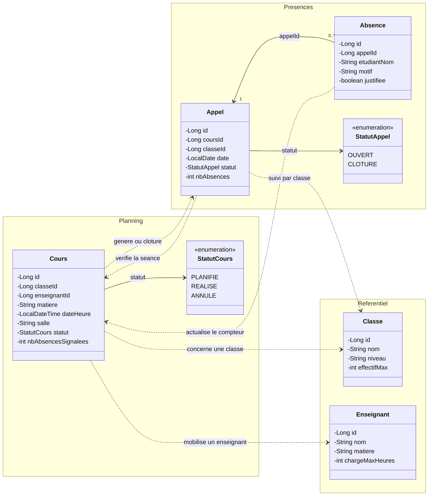
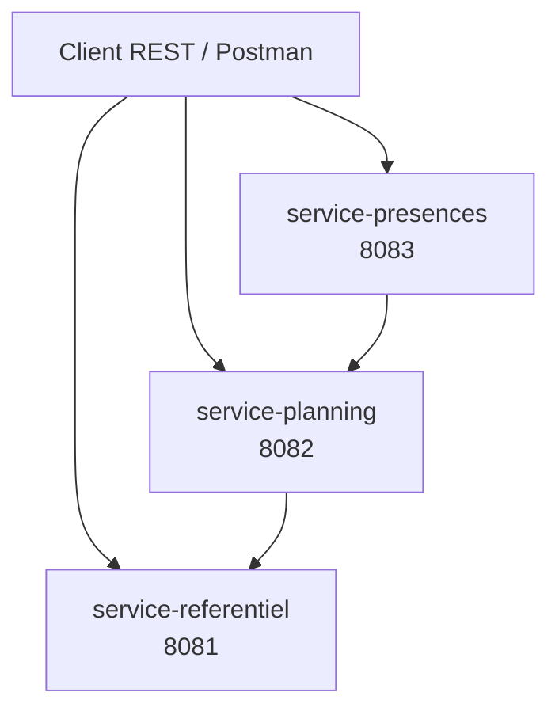

# Planif-Scolaire

Version 1.0 — services métier et API REST.

## Description

Planif-Scolaire permet de planifier les cours d'un établissement et de suivre les absences. Chaque séance associe une classe, une matière, un enseignant, un créneau et une salle. Sa création génère une feuille d'appel. Après la réalisation du cours, les absences saisies mettent à jour son compteur de suivi. L'annulation d'une séance clôture la feuille d'appel.

Le cours suit le cycle `PLANIFIE → REALISE` ou `PLANIFIE → ANNULE`.

## Diagramme de classes UML



Les groupes `Referentiel`, `Planning` et `Presences` correspondent aux trois services métier. Les flèches en pointillés représentent leurs dépendances, sans préciser le protocole de communication. Les références entre services sont conservées sous forme d'identifiants.

Un cours appartient à une seule classe et mobilise un seul enseignant. Une classe ou un enseignant peut être associé à plusieurs cours. Une séance possède au maximum une feuille d'appel, créée après la planification. Chaque absence appartient à un seul appel.

## Architecture de la version 1.0

| Application | Port | Rôle |
| --- | --- | --- |
| `service-referentiel` | 8081 | Classes et enseignants |
| `service-planning` | 8082 | Séances de cours et suivi des absences |
| `service-presences` | 8083 | Feuilles d'appel et absences |



Les API sont accessibles directement sur le port de chaque service. Les URL des services appelés sont configurables avec `REFERENTIEL_URL` (par défaut `http://localhost:8081`) et `PLANNING_URL` (par défaut `http://localhost:8082`).

## Services métier

Chaque application est un module Maven indépendant avec son propre `pom.xml`, son wrapper Maven et sa classe principale Spring Boot. Le POM racine permet de les importer ensemble dans IntelliJ IDEA.

Les contrôleurs exposent les API et valident les DTO avec `@Valid`. Les services portent les règles métier et les transactions. Les repositories Spring Data JPA accèdent aux données. Les mappers MapStruct assurent la conversion entre entités et DTO. Un `@RestControllerAdvice` traduit les erreurs métier et de validation en réponses HTTP.

| Service | Données | Base locale par défaut |
| --- | --- | --- |
| service-referentiel | Classes, enseignants | `./data/service-referentiel` |
| service-planning | Cours | `./data/service-planning` |
| service-presences | Appels, absences | `./data/service-presences` |

Chaque service possède sa base H2 ; les références entre services utilisent des identifiants. Les chemins des bases sont relatifs au dossier de lancement. Les données ne sont pas déposées sur Git.

## Lancement dans IntelliJ IDEA

Prérequis : JDK 17 et Docker Compose pour Kafka. Les modules utilisent Spring Boot 3.5.6, Spring Cloud 2025.0.0 et MapStruct 1.6.3.

1. Ouvrir le `pom.xml` racine comme projet Maven, puis recharger les projets Maven.
2. Choisir le JDK 17 dans Project SDK et dans le runner Maven.
3. Démarrer Kafka depuis la racine : `docker compose up -d`.
4. Exécuter `ServiceReferentielApplication`, `PlanningApplication` et `PresencesApplication` dans des configurations distinctes.

Chaque service est également lançable depuis son propre dossier :

```powershell
.\mvnw.cmd spring-boot:run
```

Les applications s'exécutent dans des processus séparés. Les opérations de planification utilisent le référentiel et les opérations de présence utilisent le planning. Les appels utilisent les URL configurées. Kafka crée les feuilles d'appel à partir des cours planifiés ; attendre leur disponibilité avant la saisie des absences. Le cours doit être `REALISE` pour accepter une absence.

## API REST

| Service | Méthode et chemin | Résultat |
| --- | --- | --- |
| Référentiel | `GET /api/classes`, `GET /api/classes/{id}` | Liste ou détail des classes |
| Référentiel | `POST /api/classes`, `PUT /api/classes/{id}` | Création ou modification |
| Référentiel | `GET /api/enseignants`, `GET /api/enseignants/{id}` | Liste ou détail des enseignants |
| Référentiel | `POST /api/enseignants`, `PUT /api/enseignants/{id}` | Création ou modification |
| Planning | `GET /api/cours`, `GET /api/cours/{id}` | Liste ou détail des cours |
| Planning | `POST /api/cours` | Création d'une séance |
| Planning | `PATCH /api/cours/{id}/statut` | Passage à `REALISE` ou `ANNULE` |
| Présences | `GET /api/appels`, `GET /api/appels/{id}` | Liste ou détail des appels |
| Présences | `GET /api/appels/cours/{coursId}` | Appel d'un cours |
| Présences | `GET /api/appels/{id}/absences` | Absences d'un appel |
| Présences | `POST /api/appels/{id}/absences` | Saisie d'une absence |

Les réponses utilisent `200` pour une lecture ou une modification, `201` avec un en-tête `Location` pour une création, `400` pour un DTO invalide, `404` pour une ressource introuvable, `409` pour un conflit métier, `422` pour une référence distante inexistante et `503` pour un service distant indisponible. Les erreurs métier et de validation contiennent notamment `status`, `title` et `detail`.

## Tests Postman

Importer [la collection Postman](postman/Planif-Scolaire.postman_collection.json), puis lancer ses **22 requêtes dans l'ordre** avec le Collection Runner, une itération et un délai de **1000 ms** entre les requêtes. Les variables `referentielUrl`, `planningUrl` et `presencesUrl` ciblent les ports 8081, 8082 et 8083.

La collection crée ses données et conserve les identifiants automatiquement. Elle vérifie les créations et lectures, une modification, les erreurs de validation `400`, les ressources inexistantes `404` dans chaque service et les conflits `409`. Elle attend la création asynchrone de l'appel, avec au maximum 30 nouvelles tentatives. Les données de test sont conservées dans les bases ; chaque exécution utilise de nouveaux noms et une nouvelle salle.

| Domaine | Cas valide | Validation | Ressource inexistante |
| --- | --- | --- | --- |
| Classes | Création, lecture, modification | Nom vide et effectif nul | Lecture d'un ID absent |
| Enseignants | Création, lecture | Nom et matière vides, charge nulle | Lecture d'un ID absent |
| Cours | Création, lecture, réalisation | Champs obligatoires absents | Lecture d'un ID absent |
| Présences | Lecture d'appel, saisie et liste d'absences | Nom et motif absents | Lecture et saisie sur un appel absent |

## Tests automatisés

Depuis la racine :

```powershell
.\mvnw.cmd clean verify
```

Les tests couvrent les règles métier, les validations HTTP, les ressources inexistantes et le parcours cours–appel–absence. Le test de parcours utilise des bases en mémoire et Kafka embarqué, sans Docker. Le module `integration-tests` est un module de tests, pas une application métier supplémentaire.

## Livraison

Le tag Git `v1.0` identifie le jalon des services métier. Le commit initial de conception reste dans l'historique.
