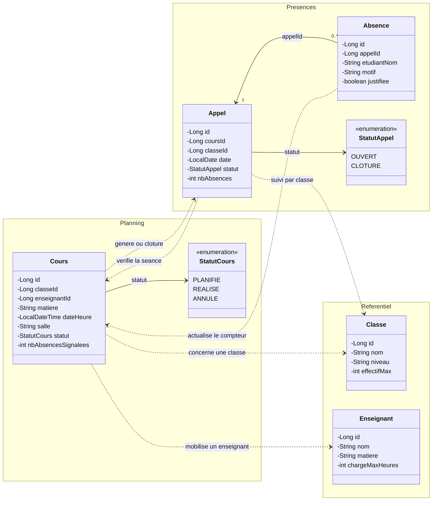
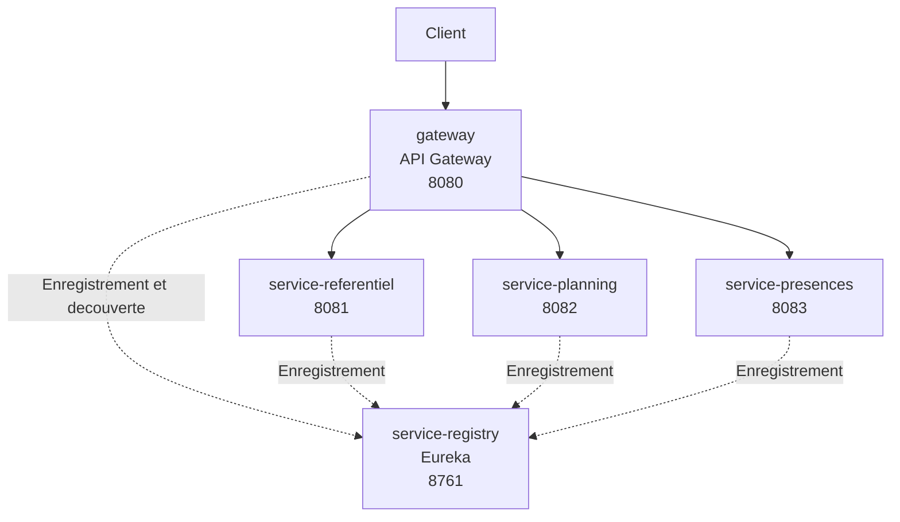

# Planif-Scolaire

Version initiale — présentation et conception du projet.

## Description

Planif-Scolaire permet de planifier les cours d'un établissement et de suivre les absences. Chaque séance associe une classe, une matière, un enseignant, un créneau et une salle. Sa création génère une feuille d'appel. Après la réalisation du cours, les absences saisies mettent à jour son compteur de suivi. L'annulation d'une séance clôture la feuille d'appel.

Le cours suit le cycle `PLANIFIE → REALISE` ou `PLANIFIE → ANNULE`.

## Diagramme de classes UML

Les groupes `Referentiel`, `Planning` et `Presences` correspondent aux trois services métier. Les flèches en pointillés représentent leurs dépendances, sans préciser le protocole de communication. Les références entre services sont conservées sous forme d'identifiants.

Un cours appartient à une seule classe et mobilise un seul enseignant. Une classe ou un enseignant peut être associé à plusieurs cours. Une séance possède au maximum une feuille d'appel, créée après la planification. Chaque absence appartient à un seul appel.

## Architecture

| Application | Port | Rôle |
| --- | --- | --- |
| `service-referentiel` | 8081 | Classes et enseignants |
| `service-planning` | 8082 | Séances de cours et suivi des absences |
| `service-presences` | 8083 | Feuilles d'appel et absences |
| `service-registry` | 8761 | Registre Eureka |
| `gateway` | 8080 | API Gateway |

Les services métier et la Gateway s'enregistrent auprès de `service-registry`. La Gateway utilise ce registre pour trouver les instances disponibles.
