# Planif-Scolaire — documentation détaillée

> Planification des cours et suivi des absences avec une architecture **microservices Spring Boot / Spring Cloud**.

    

## Sommaire

1. [En bref](#1-en-bref)
2. [Architecture globale](#2-architecture-globale)
3. [Évolution du projet V0 → V6](#3-évolution-du-projet-v0--v6)
4. [Modèle de données](#4-modèle-de-données)
5. [Cycles de vie](#5-cycles-de-vie)
6. [Scénarios de communication](#6-scénarios-de-communication)
7. [Résilience et limitation de débit](#7-résilience-et-limitation-de-débit)
8. [Configuration centralisée](#8-configuration-centralisée)
9. [Lancement](#9-lancement)
10. [API REST](#10-api-rest)
11. [Données de démonstration](#11-données-de-démonstration)
12. [Tests](#12-tests)
13. [Interface web](#13-interface-web)
14. [Structure du dépôt](#14-structure-du-dépôt)

---

## 1. En bref

Chaque séance associe une **classe**, une **matière**, un **enseignant**, un **créneau** et une **salle**.

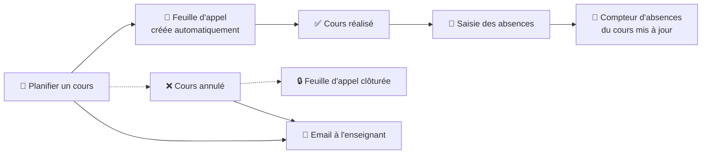

| Port | Application | Rôle |
| ---: | --- | --- |
| 8080 | `gateway-service` | Point d'entrée unique : routage, découverte, limitation de débit |
| 8081 | `service-referentiel` | Classes et enseignants |
| 8082 | `service-planning` | Séances de cours |
| 8083 | `service-presences` | Feuilles d'appel et absences |
| 8084 | `notification-service` | Emails déclenchés par Kafka |
| 8085 | `service-utilisateurs` | Étudiants, enseignants, admins |
| 8761 | `service-registry` | Annuaire Eureka |
| 8888 | `config-server` | Configuration centralisée (`config-repo`) |
| 4200 | `frontend` | Interface web d'administration |
| 9092 · 6379 · 1025/8025 | Kafka · Redis · Mailpit | Infrastructure (Docker Compose) |

---

## 2. Architecture globale

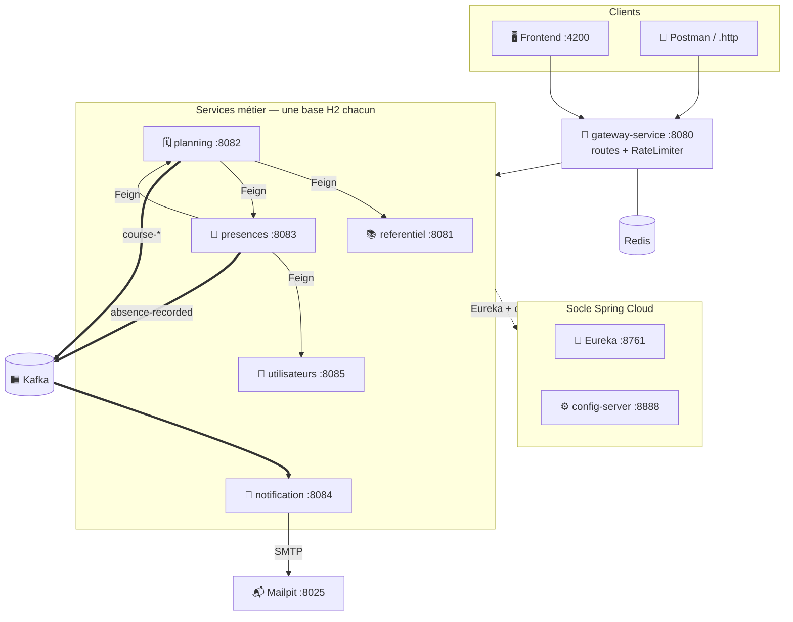

**Légende**

| Trait | Signification |
| --- | --- |
| `──▶` Feign | Appel **synchrone** HTTP via OpenFeign, résolu par Eureka (`lb://`) |
| `══▶` topic | Message **asynchrone** Kafka (publié via le pattern Outbox) ; les consommateurs sont détaillés en 6.4 |
| `- - ▶` | Tous les services (Gateway compris) s'enregistrent dans Eureka et chargent leur configuration au démarrage |

### Synchrone ou asynchrone ?

| Besoin | Mode | Pourquoi |
| --- | --- | --- |
| Vérifier qu'une classe ou un enseignant existe avant de planifier | Feign (synchrone) | Le résultat conditionne la réponse HTTP |
| Vérifier qu'un étudiant est actif avant une absence | Feign (synchrone) | Idem |
| Créer la feuille d'appel après la planification | Kafka (asynchrone) | Le planning ne doit pas attendre les présences |
| Mettre à jour le compteur d'absences du cours | Kafka (asynchrone) | Découplage, tolérance aux pannes |
| Envoyer un email | Kafka (asynchrone) | Un SMTP lent ne bloque pas l'API |

---

## 3. Évolution du projet V0 → V6

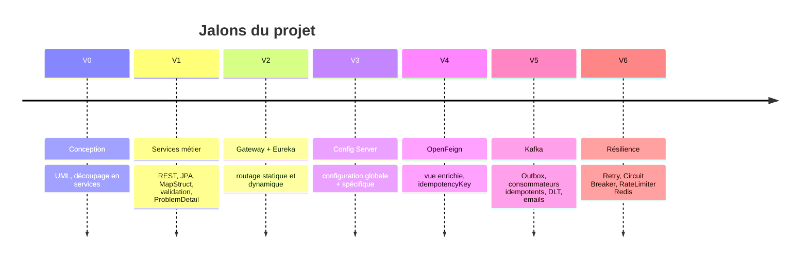

| Version | Ce qui a été ajouté | Où le voir dans le code |
| --- | --- | --- |
| V0 | Diagramme UML, une base par service | Section 4 |
| V1 | CRUD, `@Valid`, `@RestControllerAdvice` | `*/controller`, `*/exception` |
| V2 | `gateway-service`, `service-registry` | `config-repo/gateway-service.properties` |
| V3 | `config-server`, `config-repo/application.properties` | `config-repo/` |
| V4 | `ReferentielClient`, `PresencesClient`, `UtilisateursClient`, `/detail` | `*/client` |
| V5 | `OutboxPublisher`, `ProcessedEvent`, `notification-service` | `*/event` |
| V6 | `@CircuitBreaker`, `@Retry`, `RequestRateLimiter` | `Resilient*Lookup`, Gateway |

---

## 4. Modèle de données

Chaque service possède **sa propre base** (*Database per Service*). Les liens entre services sont de simples **identifiants**, jamais des clés étrangères.

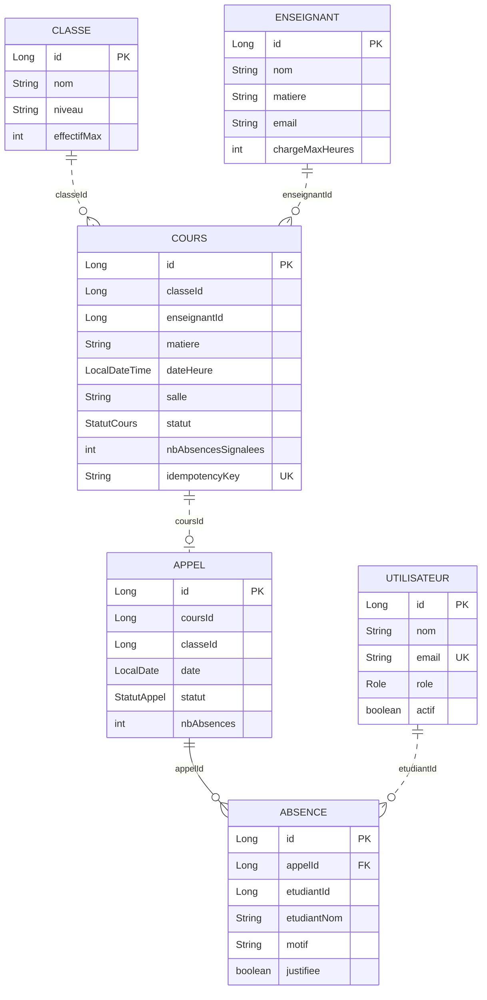

Les traits **pleins** sont de vraies relations JPA dans une même base. Les traits **pointillés** sont des références par identifiant entre deux services.

| Base H2 | Service | Tables |
| --- | --- | --- |
| `./data/service-referentiel` | referentiel | `classe`, `enseignant` |
| `./data/service-utilisateurs` | utilisateurs | `utilisateur` |
| `./data/service-planning` | planning | `cours`, `outbox_event`, `processed_event`, `operation_lock` |
| `./data/service-presences` | presences | `appel`, `absence`, `outbox_event`, `processed_event`, `operation_lock` |
| `./data/notification-service` | notification | `notification_delivery` (`PENDING` / `SENT` / `FAILED`) |

### Couches d'un service métier

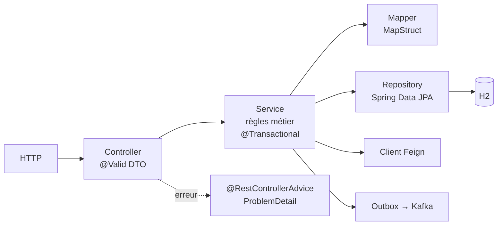

---

## 5. Cycles de vie

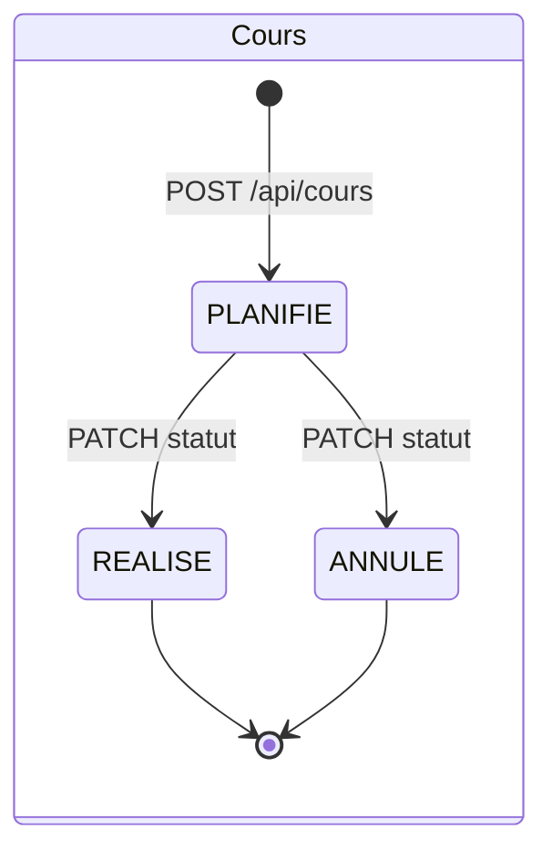

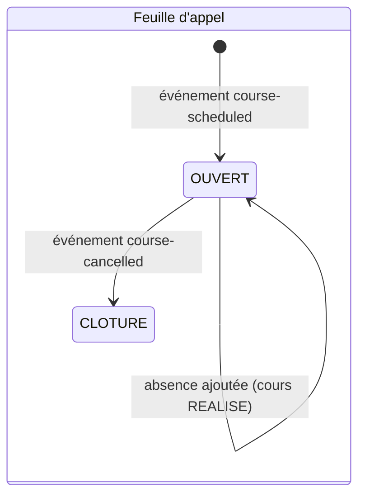

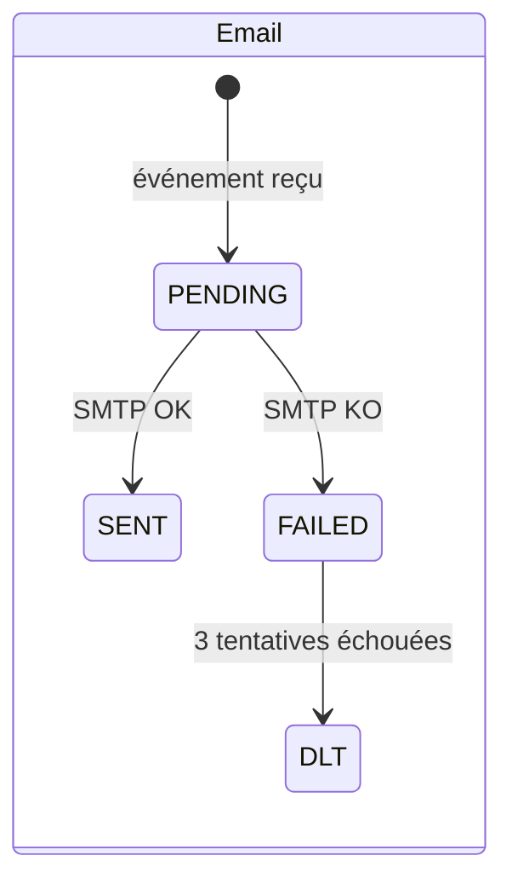

---

## 6. Scénarios de communication

### 6.1 Planifier un cours

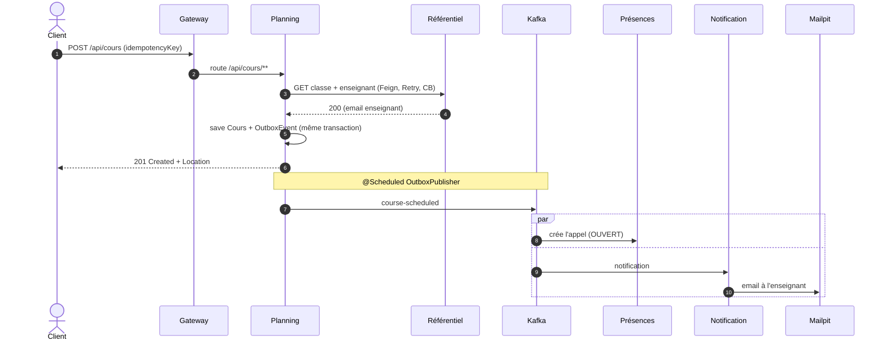

### 6.2 Saisir une absence

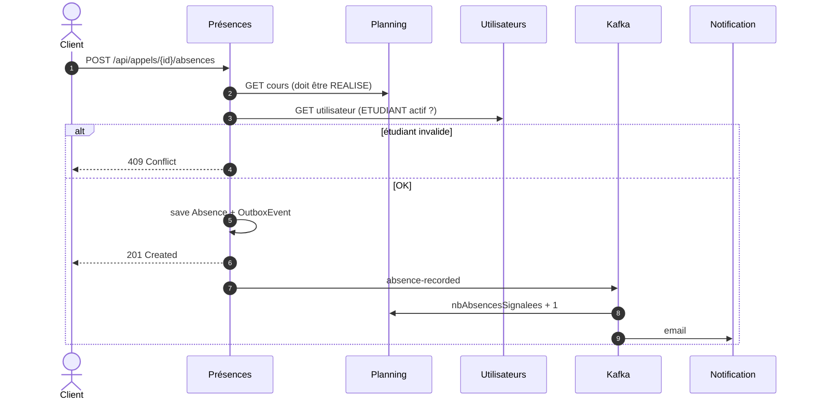

### 6.3 Vue enrichie d'un cours

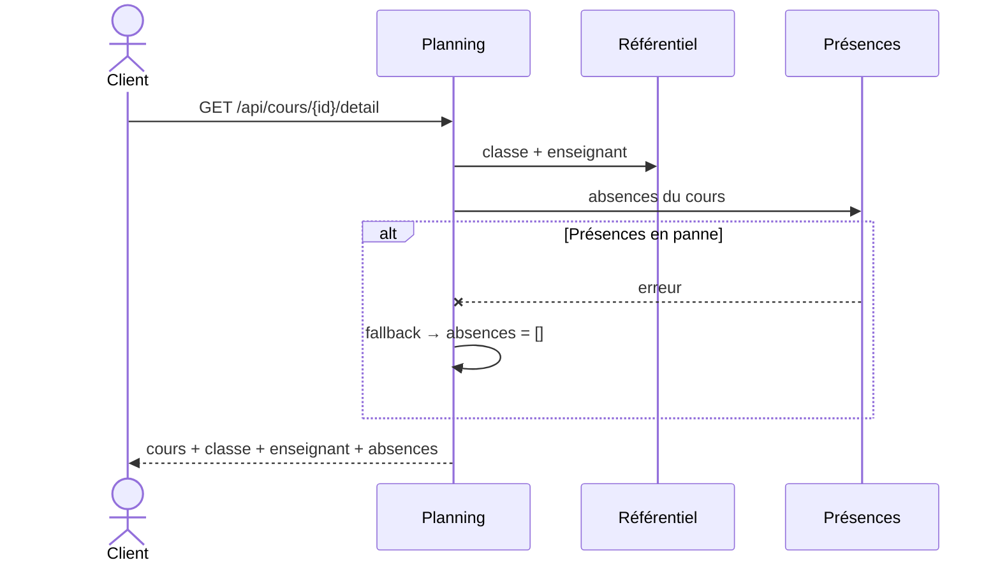

### 6.4 Topics Kafka

| Topic | Producteur | Consommateurs | Effet |
| --- | --- | --- | --- |
| `course-scheduled` | planning | presences, notification | Crée la feuille d'appel, envoie un email |
| `course-cancelled` | planning | presences, notification | Clôture la feuille d'appel, envoie un email |
| `absence-recorded` | presences | planning, notification | Incrémente le compteur, envoie un email |
| `<topic>.DLT` | Kafka (après 3 échecs) | — | Garde les messages en échec |

**Fiabilité :** pattern **Outbox** côté producteur (l'événement est écrit en base dans la même transaction que la donnée), table **ProcessedEvent** côté consommateur (un `eventId` déjà traité est ignoré).

---

## 7. Résilience et limitation de débit

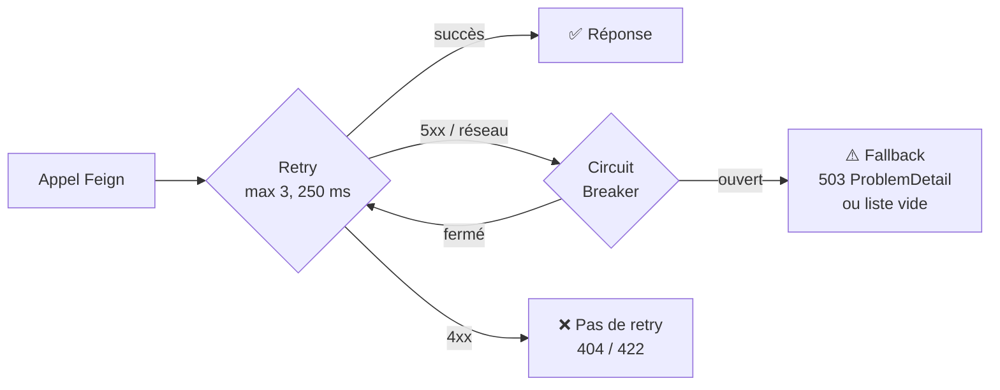

| Instance | Où | Fallback |
| --- | --- | --- |
| `referentiel*` | planning → référentiel | `503` |
| `presencesAbsences` | planning → présences | `absences = []` |
| `planning*` | présences → planning | `503` |
| `utilisateursEtudiant` | présences → utilisateurs | `503` |

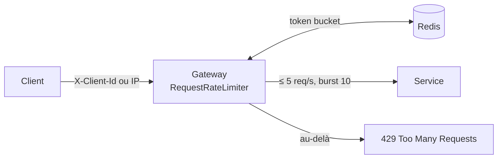

---

## 8. Configuration centralisée

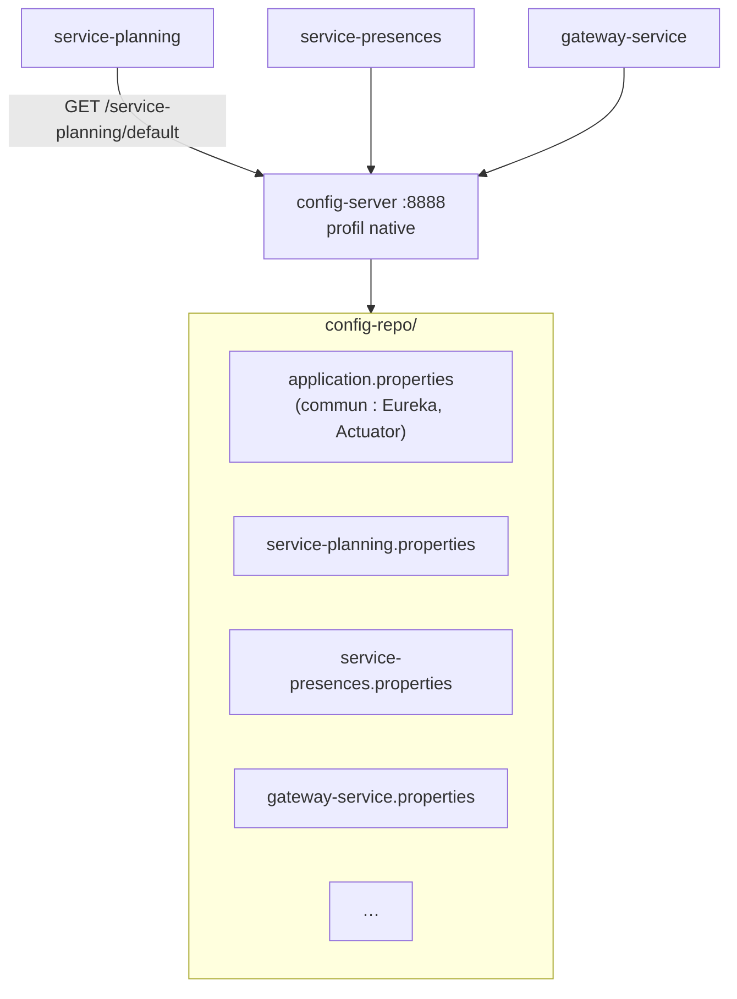

Vérification : `GET http://localhost:8888/service-planning/default` retourne les deux sources (spécifique + globale).

| Variable | Rôle |
| --- | --- |
| `CONFIG_REPO_LOCATION` | Dossier `config-repo` si lancé depuis un autre dossier |
| `CONFIG_SERVER_PROFILE=git` | Lire la configuration depuis Git |
| `CONFIG_SERVER_URL` | Cibler un autre serveur de configuration |
| `EUREKA_URL` | Adresse Eureka |
| `PLANNING_URL`, `PRESENCES_URL`, `UTILISATEURS_URL` | URL fixe pour Feign (vide = Eureka) |
| `NOTIFICATION_RECIPIENT` | Destinataire si l'enseignant n'a pas d'email |
| `APP_SEED_LOCATION` | Script de données de démonstration |

---

## 9. Lancement

**Prérequis :** JDK 17, Docker Desktop. Ouvrir le `pom.xml` racine dans IntelliJ IDEA (chaque module garde son propre `pom.xml` et son wrapper Maven).

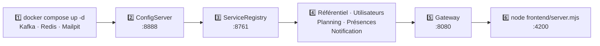

```powershell
docker compose up -d
# puis dans chaque dossier de service, ou via les configurations IntelliJ :
.\mvnw.cmd spring-boot:run
```

Sur macOS ou Linux : `./mvnw spring-boot:run`.

> ⚠️ Kafka doit être prêt avant planning, présences et notifications. Redis doit être prêt avant le Gateway. Pour une base H2 du planning créée avant le TP4, exécuter `scripts/migrate-planning-tp4.sql` après une sauvegarde du fichier `.mv.db`.

| Interface | URL |
| --- | --- |
| Tableau Eureka | http://localhost:8761 |
| Mailpit | http://localhost:8025 |
| Frontend | http://localhost:4200 |

---

## 10. API REST

Toutes les routes passent par la Gateway (`http://localhost:8080`) ; chaque service reste aussi accessible sur son port.

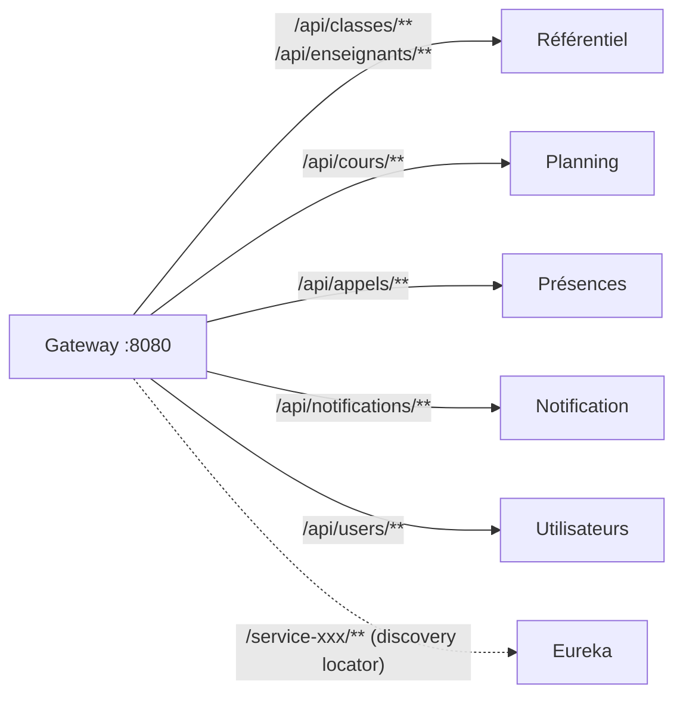

| Service | Méthode et chemin | Résultat |
| --- | --- | --- |
| Référentiel | `GET` `POST` `/api/classes` · `GET` `PUT` `DELETE` `/api/classes/{id}` | CRUD classes (`DELETE` → `204`) |
| Référentiel | `GET` `POST` `/api/enseignants` · `GET` `PUT` `DELETE` `/api/enseignants/{id}` | CRUD enseignants (`email` optionnel) |
| Utilisateurs | `GET` `POST` `/api/users` · `GET` `PUT` `DELETE` `/api/users/{id}` | CRUD utilisateurs (`409` si email déjà utilisé) |
| Planning | `GET /api/cours` · `GET /api/cours/{id}` | Liste ou détail |
| Planning | `POST /api/cours` | Création, en-tête `idempotencyKey` obligatoire |
| Planning | `GET /api/cours/{id}/detail` | Cours + classe + enseignant + absences |
| Planning | `PATCH /api/cours/{id}/statut` | `REALISE` ou `ANNULE` |
| Présences | `GET /api/appels` · `GET /api/appels/{id}` · `GET /api/appels/cours/{coursId}` | Feuilles d'appel |
| Présences | `GET` `POST` `/api/appels/{id}/absences` | Absences (`etudiantId` vérifié, ou `etudiantNom`) |
| Notifications | `GET /api/notifications/cours/{coursId}` · `GET /api/notifications/{eventId}` | Statut des emails |

### Codes de réponse

| Code | Quand |
| :---: | --- |
| `200` | Lecture ou modification |
| `201` | Création, avec en-tête `Location` |
| `204` | Suppression |
| `400` | DTO invalide, ou `idempotencyKey` déjà utilisée |
| `404` | Ressource introuvable (ou référence distante absente, côté planning) |
| `409` | Conflit métier (doublon, étudiant inactif…) |
| `422` | Référence distante absente, côté présences |
| `429` | Quota Gateway dépassé |
| `502` · `503` | Erreur ou indisponibilité d'un service distant |

Les erreurs suivent le format `ProblemDetail` : `status`, `title`, `detail`.

---

## 11. Données de démonstration

Au démarrage, chaque service charge `src/main/resources/seed-demo.sql` (ids **1001+**, rechargés à chaque démarrage).

| Service | Données |
| --- | --- |
| Référentiel | Classes 1001–1004 (5IIR-A, 5IIR-B, 4IIR-A, 3IIR-C) · Enseignants 1001–1004 avec email |
| Utilisateurs | 1001–1003 étudiants actifs · 1004 étudiant inactif · 1005 admin |
| Planning | Cours 1001 `REALISE` · 1002 et 1003 `PLANIFIE` · 1004 `ANNULE` |
| Présences | Appels 1001–1004 (1004 `CLOTURE`) · 2 absences sur l'appel 1001 |

Tests prêts à l'emploi : [collection DEMO](../postman/Planif-Scolaire-DEMO.postman_collection.json) (25 requêtes) et `http/06-donnees-demo.http`.

---

## 12. Tests

### Tests automatisés

```powershell
.\mvnw.cmd clean verify
```

Ils couvrent les règles métier, les validations HTTP, les ressources inexistantes et le parcours cours → appel → absence (bases en mémoire + Kafka embarqué, sans Docker). `notification-service` teste l'envoi, l'idempotence et la persistance d'un échec SMTP. `integration-tests` est un module de tests, pas une application.

### Postman

Importer [la collection](../postman/Planif-Scolaire.postman_collection.json) et lancer ses **39 requêtes dans l'ordre** (Collection Runner, 1 itération, délai **1000 ms**).

| Domaine | Cas valide | Validation `400` | Inexistant `404` |
| --- | --- | --- | --- |
| Classes | Création, lecture, modification, suppression | Nom vide, effectif nul | ID absent |
| Enseignants | Création, lecture | Nom, matière vides, charge nulle | ID absent |
| Utilisateurs | CRUD complet | — | ID absent, `409` email en double |
| Cours | Création, lecture, réalisation, détail | Champs absents | ID absent |
| Présences | Lecture d'appel, saisie par nom ou `etudiantId` | Nom et motif absents | Appel absent |
| Gateway | Routes statiques et dynamiques | — | `429` après un burst |
| Notifications | Statut `SENT` de l'email | — | — |

L'appel est créé de façon asynchrone : la collection réessaie jusqu'à 30 fois. Chaque exécution utilise de nouveaux noms et une nouvelle salle.

---

## 13. Interface web

`frontend/` est une interface d'administration qui passe uniquement par la Gateway. Lancement : `node frontend/server.mjs`, puis http://localhost:4200 ([détails](../frontend/README.md)).

| | |
| :---: | :---: |
| 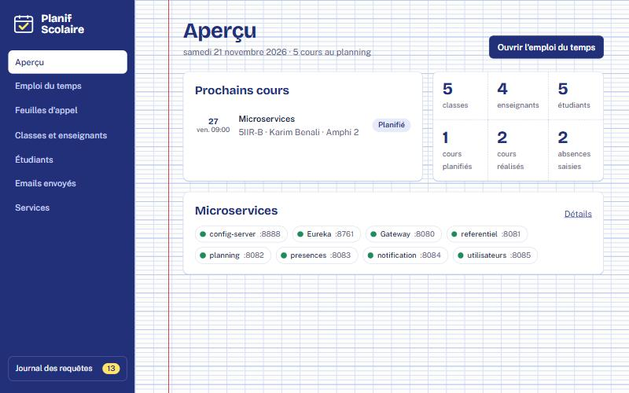 **Aperçu** | 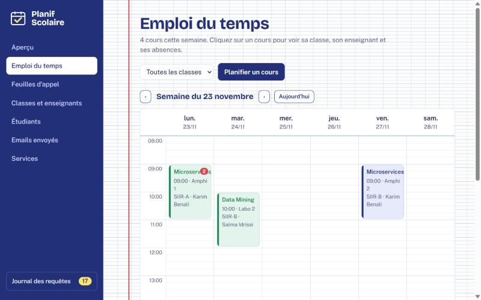 **Emploi du temps** |
| 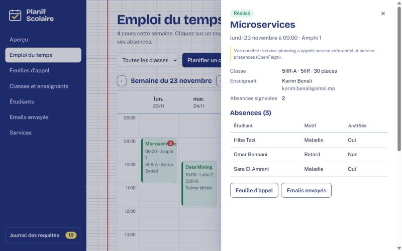 **Vue enrichie d'un cours** | 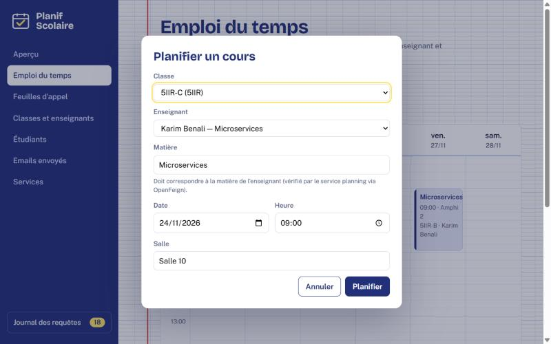 **Planifier un cours** |
| 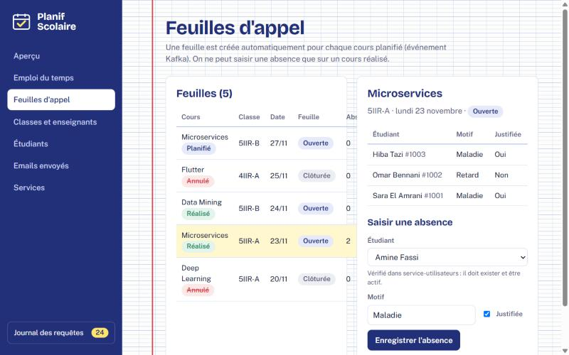 **Feuilles d'appel** | 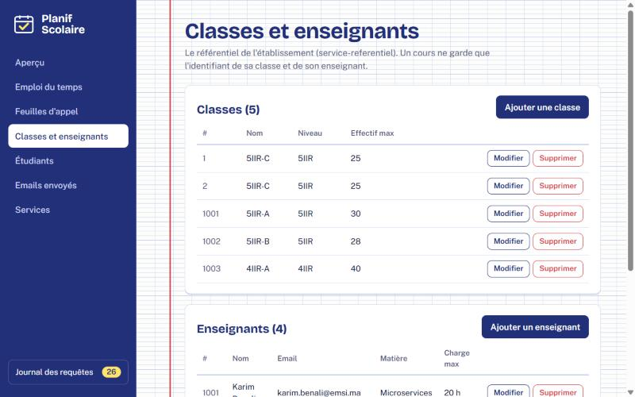 **Classes et enseignants** |
| 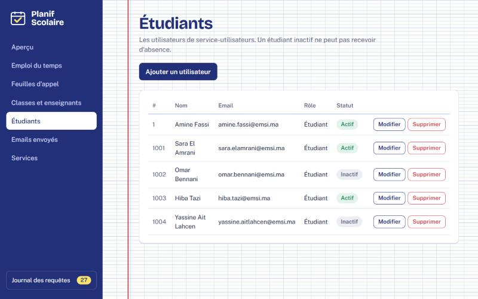 **Étudiants** | 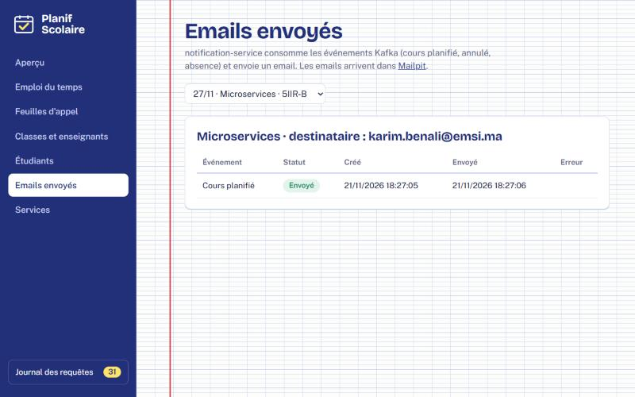 **Emails envoyés** |
| 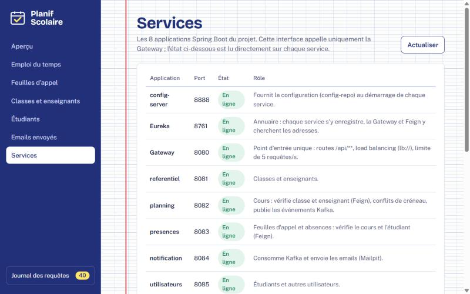 **Santé des services** | 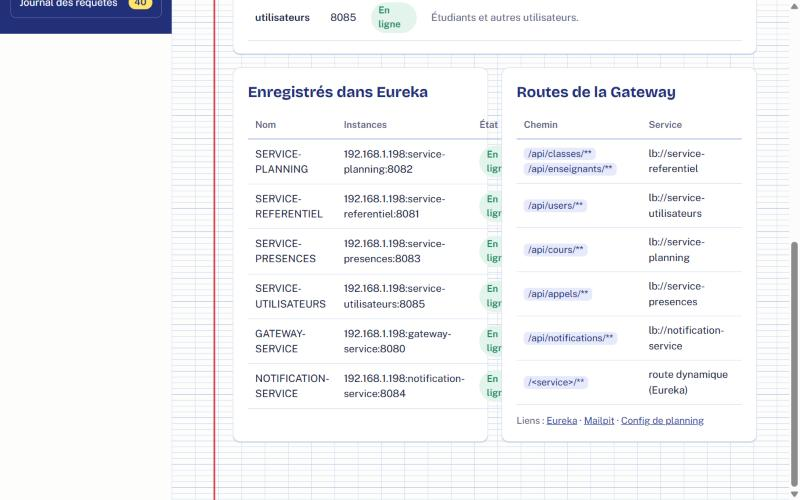 **Eureka et routes** |

---

## 14. Structure du dépôt

```text
Planif-Scolaire/
├── config-repo/            # configuration externalisée (globale + par service)
├── config-server/          # Spring Cloud Config        :8888
├── service-registry/       # Eureka                     :8761
├── gateway-service/        # Spring Cloud Gateway       :8080
├── service-referentiel/    # classes, enseignants       :8081
├── service-planning/       # cours, Outbox              :8082
├── service-presences/      # appels, absences, Outbox   :8083
├── notification-service/   # emails Kafka → SMTP        :8084
├── service-utilisateurs/   # utilisateurs               :8085
├── integration-tests/      # parcours de bout en bout
├── frontend/               # interface web              :4200
├── postman/                # collections Postman
├── http/                   # requêtes IntelliJ HTTP Client
├── captures/               # captures de l'interface web
├── scripts/                # migrations SQL
├── docs/                   # rapport V5–V6
└── compose.yaml            # Kafka, Redis, Mailpit
```

**Livraison :** le tag Git `v1.0` identifie le jalon des services métier ; le commit initial de conception reste dans l'historique.
